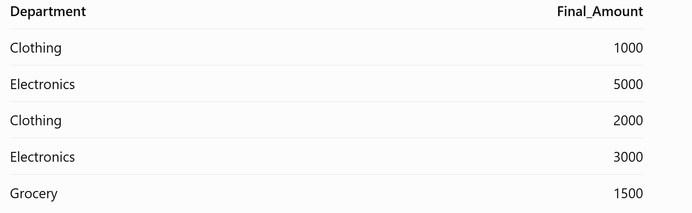
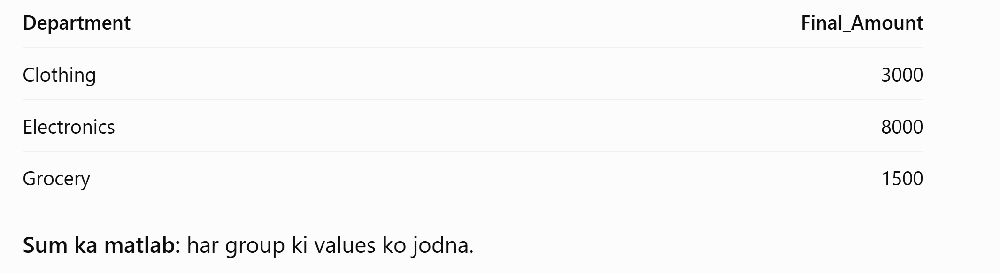

Step 1: df.groupby('Department')
df.groupby('Department')
Ye data ko Department ke according groups mein divide karta hai.

Step 2: ['Final_Amount']
df.groupby('Department')['Final_Amount']
Har Department ke group mein se sirf Final_Amount column select karta hai.

Step 3: .sum()
df.groupby('Department')['Final_Amount'].sum()
Har Department ki total sales calculate karta hai.

Step 4: .sort_values(ascending=False)
.sort_values(ascending=False)
Total sales ko descending order mein arrange karta hai, yani sabse badi value se sabse chhoti value tak.

ascending=True → chhoti se badi value.

ascending=False → badi se chhoti value.