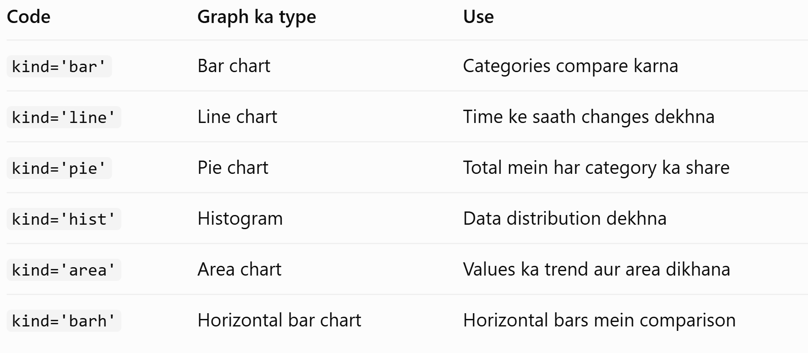

Python = Interactive Python
Notebook = Ek document jisme code, output aur explanation likh sakte hain.
.ipynb = IPython Notebook file extension.

------------------------------------------------
sns.set_theme(style='whitegrid')
- sns → Seaborn library ka short name.
- set_theme() → Graph ka overall look aur design set karta hai.
- style='whitegrid' → Graph ke background par white color aur grid lines set karta hai, jisse values ko samajhna easy hota hai.
------------------------------------------------------------

2. plt.rcParams['figure.figsize'] = (8, 5)
- plt → Matplotlib library ka short name.
- rcParams → Matplotlib ki default settings ko control karta hai.
- figure.figsize → Graph ki default width aur height set karta hai.
- (8, 5) → Width 8 inches aur height 5 inches.

errors='coerce' — Agar koi value valid date mein convert nahi ho sakti, toh use NaT(note a time) bana deta hai. NaT ka matlab hai missing ya invalid date.

Datetime format ka fayda: Ab hum dates par sorting, month-wise grouping aur date calculations kar sakte hain.

.min() — sabse purani date.

.max() — sabse nayi date.

df['Date'].dt=Datetime column se date-related information nikalne ke liye use hota hai, jaise month, year aur day.

.to_period('M') ='M' ka matlab monthly period hai. Ye date se month aur year nikalta hai.
.astype(str) =Month period ko string yani text format mein convert karta hai.
Finally, ye poori line naya Month column bana deti hai.

# Is section mein hum sales se related important numbers calculate karenge.

# - Final_Amount: Ye discount lagne ke baad ki sales amount hai. Matlab customer ne discount ke baad jitne paise pay kiye.
# - Total_Amount: Ye discount lagne se pehle ki amount hai. Matlab discount dene se pehle product ki total price.

df['Total_Amount'].sum() discount se pehle ki saari amounts ko add karta hai.
.format() number ko readable format mein dikhata hai.
₹ Indian Rupee ka symbol hai.

₹{:,.2f} =, numbers ko comma ke saath format karta hai.

.2f decimal ke baad 2 digits dikhata hai.

Function	Kaam
len(df)	Total rows count karna
.sum()	Total nikalna
.mean()	Average nikalna
round(value, 2)	2 decimal places tak round karna
'{:,.2f}'.format(value)	Number ko commas aur 2 decimal places ke saath dikhana

display() calculated result ko notebook mein achhe format mein show karta hai.

------------------------------------

department_sales.plot(kind='bar', color='steelblue')
-----------------------------------------------------------------
.plot() graph banata hai.
kind='bar' vertical bar chart banata hai.
color='steelblue' bars ka color blue rakhta hai.
-----------------------------------------
plt.xticks(rotation=35, ha='right')
- rotation=35: Department ke names ko 35 degrees rotate karta hai.
- ha='right': Labels ko right side se align karta hai.
Kyun? Agar department names lambe hain, toh woh ek-doosre ke upar nahi chadhenge.

----------------------------------------------------

df['Discount_Percent'] — dataset ka discount percentage column select karta hai.
.value_counts() — har discount percentage kitni baar aaya hai, uski counting karta hai.
.sort_index() — discount percentages ko ascending order mein arrange karta hai, yaani chhote se bade order
 mein.

 -----------------------------
 Agar 5-star rating ki bar sabse badi hai, toh iska matlab hai ki dataset mein 5-star ratings sabse zyada baar di gayi hain. Isse customer satisfaction ka ek idea mil sakta hai, lekin actual conclusion tumhare graph ke results par depend karega.

 ----------------------------------
 - df.groupby('Month') — dataset ko month ke basis par group karta hai.
- ['Final_Amount'] — discount ke baad wali sales amount ka column select karta hai.
- .sum() — har month ki saari sales amounts ko add karta hai.
Matlab, agar January mein 100 transactions hui hain, toh un sabhi transactions ke Final_Amount ko add karke January ki total sales nikali jayegi.

Month	Sales After Discount
January 2023	₹1,21,13,307.50
February 2023	₹32,20,310.00
Yaani January 2023 mein total sales lagbhag ₹1.21 crore thi aur February 2023 mein lagbhag ₹32.20 lakh.

plot() — graph banata hai.
kind='line' — line chart banata hai, jisse months ke beech sales ka trend samajh aata hai.
marker='o' — har month ke data point par gol circle banata hai.

Yaad rakho: kind ek parameter hai jo Pandas ke .plot() method ko batata hai ki kis tarah ka graph draw karna hai.